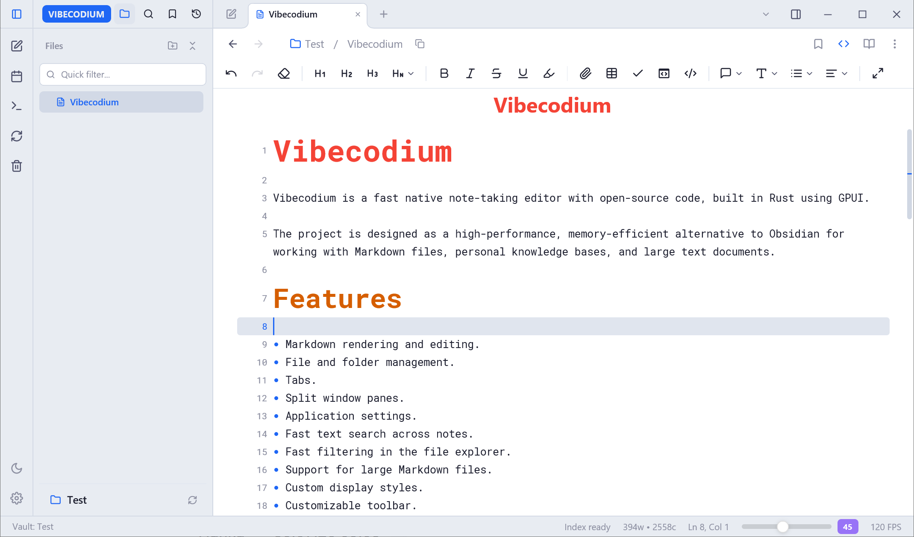

# Vibecodium

Vibecodium is a fast native note-taking editor with open-source code, built in Rust using GPUI.

The project is designed as a high-performance, memory-efficient alternative to Obsidian for working with Markdown files, personal knowledge bases, and large text documents.

## Features

- Markdown rendering and editing.
- File and folder management.
- Tabs.
- Split window panes.
- Application settings.
- Fast text search across notes.
- Fast filtering in the file explorer.
- Support for large Markdown files.
- Custom display styles.
- Customizable toolbar.
- Favorites panel.
- Recently opened files panel.
- Quick image editing.

## Large Files

Vibecodium can open and edit huge Markdown files of 1 GB or more.

## Additional Features

- Fast scrolling through long lists in the file explorer while holding the mouse wheel.
- Fast scrolling in the editor while holding the mouse wheel.
- Highlighting of non-printable characters.
- Alternative Markdown selection without expanding tags while holding Ctrl.
- Expanding all tags in a line while holding Alt.
- Instant text search.
- Multilingual interface with support for 20 languages.
- Fast file filtering in the file explorer.

## Obsidian Compatibility

Vibecodium provides partial support for Obsidian plugins.

It is not possible to fully migrate all plugins, since many of them use WebView, HTML, CSS, and other web technologies to render their interfaces and content.

For compatibility, Vibecodium uses its own API-call translator, which converts plugin calls into a format understood by Vibecodium.

The goal of the project is not to fully replicate Obsidian, but to create an independent open platform for working with Markdown files and gradually support the most useful extensions.

## Built-in Features

Some features that are usually implemented in Obsidian through plugins are built directly into Vibecodium:

- Customizable toolbar.
- Favorites panel.
- Recently opened files panel.
- Fast search.
- Fast file filtering.
- Custom display styles.

## In Development

The project is in the early stages of development. Planned features include:

- Support for formulas in Markdown.
- Expanded compatibility with Obsidian plugins.
- Bug fixes.
- Additional testing.
- Further performance optimization.

## Project Goal

Vibecodium is being built as a fast, lightweight, and open Markdown editor that combines:

- Rust performance.
- A native GPUI-based interface.
- Low memory usage.
- Support for huge files.
- User customization options.
- Independence from closed platforms.